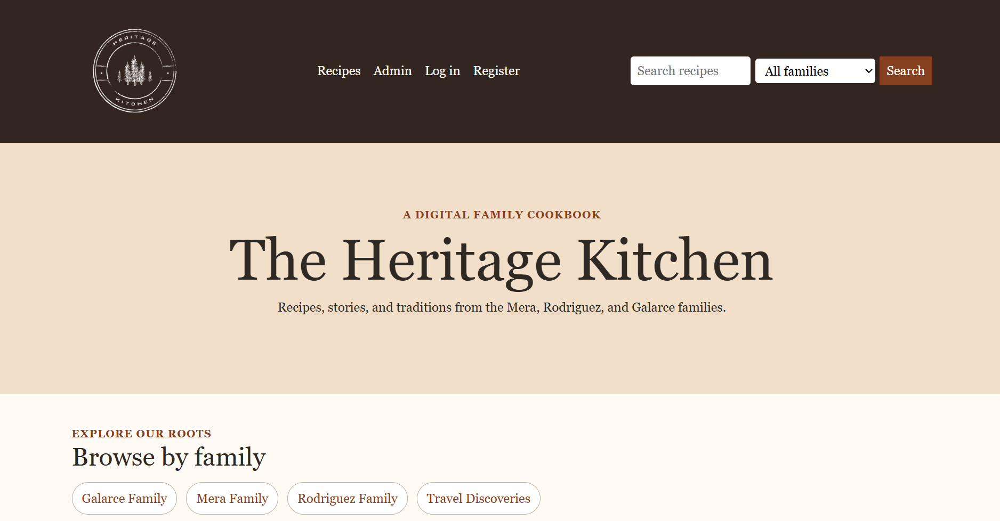
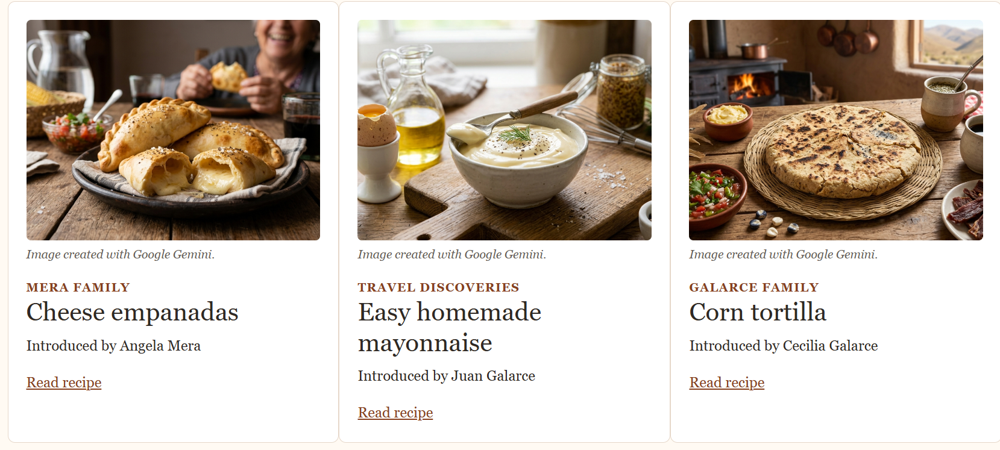

<p align="center">
  
</p>

<h1 align="center">The Heritage Kitchen</h1>

<p align="center">
  A digital family cookbook that keeps recipes, stories and family lineages from getting lost.
</p>

<p align="center">
  
  
  
  
</p>

<p align="center">
  
</p>

<p align="center">
  
</p>

## Why I built it

When I moved from Chile to Canada, I couldn't bring my aunt's recipe book with me.
The Heritage Kitchen is my answer to that: a place where each family can save its
recipes, along with who brought them into the family and the story behind them, so
they can be passed down instead of forgotten. It's built so that any family can use it.

## Roles

| Role | What they can do |
|------|------------------|
| **Visitor** | Browse recipes, explore them by family lineage, search and filter, and leave comments (protected by a CAPTCHA). |
| **Member** | Everything a visitor can do, plus create an account through the registration page and log in. |
| **Admin** | Full access to the admin dashboard: create, edit and delete recipes and family lineages, upload recipe images, moderate comments (hide or show them), and manage user accounts and roles. |

The first admin account is created through `admin/setup.php`, which locks itself
once a user exists. The system also stops you from deleting the last remaining admin.

## What I built

- **Recipe catalogue and family lineages.** Every recipe belongs to a family lineage
  (with region and description), so each family has its own space.
- **Search with filters and pagination.** Search by keyword and narrow the results
  down by family lineage.
- **Friendly permalinks.** Recipes live at clean URLs like `/12/abuelas-empanadas/`,
  using Apache `mod_rewrite`. The page only loads when the ID and the slug match.
- **Rich-text instructions.** Admins write instructions with the Quill editor. On the
  server, the HTML is cleaned against an allowlist of safe tags.
- **Image uploads.** Images are checked by their real file type, resized with PHP GD,
  saved under unique names, and deleted along with their recipe.
- **Comment moderation.** Public comments with a homemade CAPTCHA image; admins
  decide which comments are visible.
- **Authentication.** Registration, login and logout, with role-based access to the
  admin area.
- **Accessibility and responsive design.** Improved color contrast, a larger logo
  and a header that adapts to mobile.

## Security

- PDO prepared statements for every value that comes from a user
- Passwords hashed with `password_hash()`
- Session ID regenerated after login
- All output escaped with `htmlspecialchars()`
- Input validated with PHP filters (`filter_input`, `filter_var`)
- Uploads checked by their real image type, not their file extension
- The admin area is protected by a role check on every page

## Tech stack

- **Backend:** PHP 8 (PDO, GD, DOMDocument), sessions
- **Database:** MySQL / MariaDB
- **Frontend:** HTML, CSS, Bootstrap 5, Quill rich-text editor
- **Server:** Apache with `mod_rewrite` (XAMPP)

## Project structure

```text
admin/               Admin dashboard: recipes, lineages, comments, users, login
assets/              Logo and static assets
uploads/             Uploaded recipe images (ignored by Git)
captcha.php          CAPTCHA image generator
connect.php          PDO database connection
functions.php        Validation, sanitizing and URL helpers
image_functions.php  Image validation, resizing and storage
index.php            Public recipe catalogue
lineage.php          Recipes grouped by family lineage
recipe.php           Recipe details and comments
register.php         Member registration
search.php           Search, filtering and pagination
style.css            Site styles
```

## Running it locally

1. Install [XAMPP](https://www.apachefriends.org/) and start **Apache** and **MySQL**.
2. Clone this repo into `htdocs`.
3. Create a database called `heritage_kitchen` and check the credentials in `connect.php`.
4. Open the project in your browser, for example
   `http://localhost/heritage-kitchen/`.
5. Go to `admin/setup.php` to create the first admin account.

## Credits

The recipe images were created with Google Gemini.

## Author

**Mika Mera**, Web Development student at RRC Polytech, Winnipeg

[LinkedIn](https://www.linkedin.com/in/micaela-mera) · [GitHub](https://github.com/mmera21)
